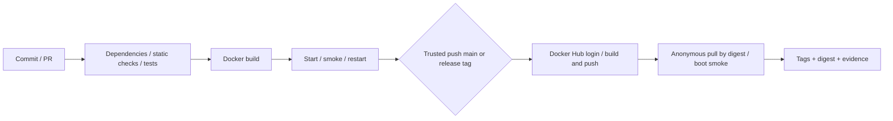

# Docker và GitHub Actions

## 1. Chạy và xác minh tại Windows PowerShell

```powershell
conda activate catcc-dinov3
python -m pip install -r requirements-web-dev.txt
python -m unittest webapp.test_webapp -v
docker build --progress=plain -t vhm-motion:local .
docker run -d --name vhm-motion -p 127.0.0.1:8000:8000 vhm-motion:local
python scripts/container_smoke.py
docker logs vhm-motion
docker inspect --format '{{json .State.Health}}' vhm-motion
docker restart vhm-motion
python scripts/container_smoke.py
```

Mở http://localhost:8000. Image không chứa classifier nên trạng thái đúng là Preview Mode. `/healthz` = 200 (process sống), `/readyz` = 503 (model chưa sẵn sàng), `/api/status` = ready false. Smoke test kỳ vọng trạng thái này và gửi upload quá 32 MiB để xác minh 413. Khi gắn model thực, không dùng smoke preview làm test model.

Dockerfile dùng Python 3.11 slim, UID 10001, một worker, cổng 8000; `MODEL_DIR=/models`, `INFERENCE_THREADS=2` (runtime giới hạn 1-4). Không cần CUDA, PyTorch hoặc Transformers trong serving. Đổi cổng host bằng `-p 8080:8000`. Giới hạn worker là theo process; không tự tăng workers khi chưa tính RAM và concurrency.

Base image đã pin digest, `requirements-web-lock.txt` khóa toàn bộ dependency serving từ build Linux đã kiểm chứng. CI áp dụng lock làm constraints. Khi cập nhật, resolve lại trên Linux/Python 3.11 và chạy toàn bộ gates; file lock chưa có wheel hashes và chưa khóa toàn bộ công cụ development.

## 2. Gắn model có provenance hợp lệ

Dùng exporter theo `RENDER_DEPLOYMENT.md`; không biến fixture ONNX thành model phục vụ. Export cần trained checkpoint, cache DINOv3 được cấp quyền, output directory rỗng và kiểm tra numerical parity. Sau export:

```powershell
$modelPath = (Resolve-Path model_artifacts).Path
docker run -d --name vhm-model -p 127.0.0.1:8001:8000 --mount "type=bind,source=$modelPath,target=/models,readonly" vhm-motion:local
Invoke-RestMethod http://localhost:8001/api/status
curl.exe -f http://localhost:8001/readyz
curl.exe -f -F "file=@PATH_TO_HELD_OUT_VIDEO.mp4" http://localhost:8001/api/analyze
```

Đường dẫn video cuối là placeholder người dùng thay bằng video được phép sử dụng. Kiểm tra đúng nhãn, timestamp, version, hash. Accuracy, macro-F1, precision, recall, confusion matrix và per-class support phải tính trên toàn bộ held-out split; không dùng mean accuracy theo batch hiện có cho kết quả chính thức. Chia theo người/nguồn video trước khi lấy frame; phát hiện trùng video và không chọn checkpoint theo test set. Đo latency warm/cold riêng, CPU/RAM và kích thước model thực; chưa có các số này ở phiên bản preview.

## 3. CI và delivery



CI tích hợp và kiểm tra thay đổi. Continuous Delivery tạo artifact có version để triển khai; workflow này tự publish image khi push main hoặc tag release hợp lệ sau gates. Continuous Deployment cần tự đưa release lên dịch vụ và kiểm tra health của release đó; hiện chưa cấu hình. Push Docker Hub không đồng nghĩa deploy Render.

Workflow `.github/workflows/ci-cd.yml` có quality, container và publish. PR không đăng nhập registry; permissions contents:read; Actions pin bằng SHA đã resolve từ upstream. pip cache và BuildKit GHA cache giảm tải. Test dùng disposable ONNX để kiểm tra API, không cần GPU hoặc gated weights. Model validation ở CI hiện là schema/checksum/contract tests, chưa phải đánh giá classifier. Checkpoint parity có PyTorch được chạy local; CI nhẹ ghi skip. SBOM và provenance được tạo khi publish; vulnerability scanning chưa triển khai, không tuyên bố image sạch CVE.

## 4. Public Docker Hub

Tạo repository `vhm-motion` ở namespace Docker Hub của bạn và chọn Public. Trong GitHub repository Settings > Secrets and variables > Actions, lưu `DOCKERHUB_USERNAME` và `DOCKERHUB_TOKEN` (token có quyền push repository). Không gửi token vào chat hoặc file Git. Nếu chọn tên repository khác, sửa biến IMAGE của publish job trước push.

Main tạo `latest` và `sha-<full commit SHA>`. Tag `v1.0.0` tạo version tag và SHA tag; kiểm tra commit thuộc main. Latest chỉ cập nhật trên main. Chỉ tạo release tag sau khi bản build được xác minh. Khi publish thành công, job anonymous pull kiểm tra public access và chạy container theo digest, không phụ thuộc latest có thể thay đổi.

Repository đã được xác minh Public: [minhstar/vhm-motion](https://hub.docker.com/r/minhstar/vhm-motion).
Image `minhstar/vhm-motion:v1.0.0` được push từ máy local ngày 31/10/2026.
Digest: `sha256:17d70e0da5dd620017be2d9fcb344f045ce4db7ae462b806edbb32e56982d7f1`.
Pull bằng Docker config rỗng đã thành công; `is_private=false` được xác minh qua Docker Hub API.
Đây là image ứng dụng Preview Mode, không chứa trained classifier.

```powershell
docker pull minhstar/vhm-motion:v1.0.0
docker run --rm -p 127.0.0.1:8000:8000 minhstar/vhm-motion:v1.0.0
```

Pull khi còn đăng nhập không tự chứng minh public. Dùng Docker config rỗng hoặc máy khác và pull digest do job ghi lại. Lưu URL run, logs, digest, screenshot trang Public và kết quả boot vào báo cáo. Branch protection nên bắt buộc quality/container; chưa thay đổi settings trên GitHub trong tác vụ này.

Source MLOps được push riêng lên nhánh `codex/mlops-delivery`, không thay đổi `main` hoặc các file nghiên cứu chưa commit. [CI run sau sửa smoke client](https://github.com/Hming6789/CA-TCC-DINOv3-Fitness/actions/runs/41189626714) kiểm tra source commit `9cef5eb828798780966be53be4efeba7554d0f4f`. Lượt đầu thất bại vì urllib vẫn gửi body lớn sau khi server trả 413 sớm; smoke client đã sửa để đọc phản hồi ngay sau Content-Length header. Bounded chunked upload vẫn được kiểm thử riêng.

Automated publish chưa được chạy: nhánh feature không thỏa điều kiện publish và GitHub Actions chưa có `DOCKERHUB_USERNAME`/`DOCKERHUB_TOKEN` tại thời điểm kiểm tra. Sau khi thêm secrets, review/merge nhánh vào main để kích hoạt delivery. Đăng nhập Docker Desktop không tự tạo GitHub Secrets. Không đánh đồng manual push thành công với CD job thành công.

## 5. Bằng chứng và tái lập

Log thực nằm ở `reports/mlops/`; báo cáo audit ở `MLOPS_AUDIT.md`, model card ở `MODEL_CARD.md`. Không commit log chứa secret; log hiện tại chỉ chứa build/test công khai. Dataset, video, weights và credential bị loại bằng Docker allowlist. Research tests trước đây chỉ là evidence lịch sử, không phải lượt đánh giá gym mới. Đối với release lâu dài, lưu full dependency lock, base-image digest, source commit, model hash, dataset split hash và workflow run URL.

Render là hướng triển khai tùy chọn có blueprint sẵn; cần tài khoản, trigger và verification riêng. Phiên bản hiện tại không tự tuyên bố đã deploy dịch vụ ngoài máy local.
